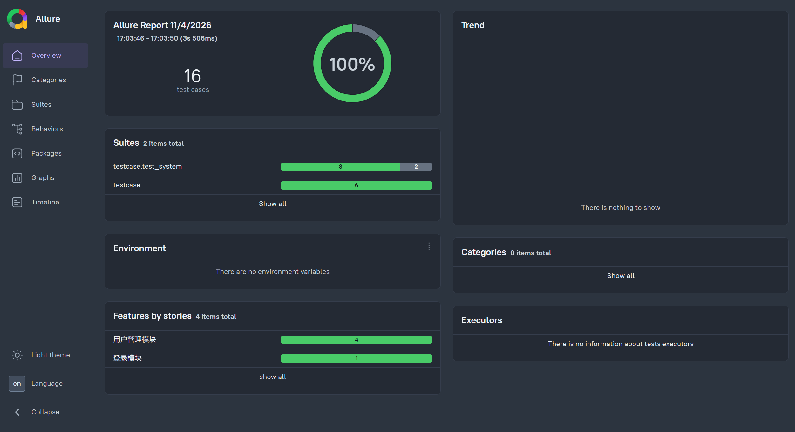
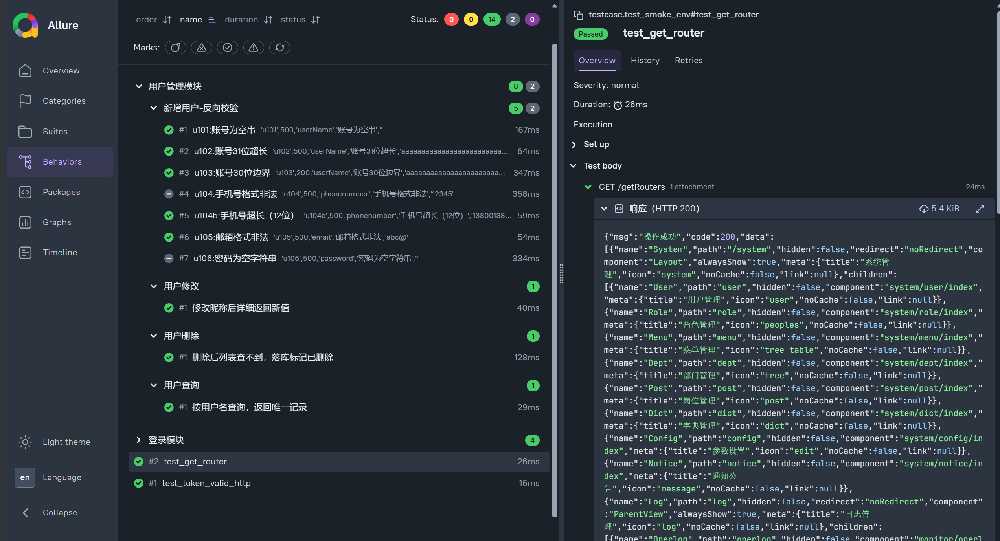

# RuoYi 后台系统接口自动化测试

基于 Python + pytest + requests + Allure 实现的 RuoYi（Flowable 版）后台系统接口自动化测试项目，
覆盖 **登录** 与 **用户管理** 两个模块，共 16 条自动化用例。

项目采用分层设计，支持数据驱动、测试数据自动构造与强制清理，输出 Allure 可视化报告，
并在测试过程中发现并记录了若干前后端校验不一致类缺陷。

---

## 目录

- [RuoYi 后台系统接口自动化测试](#ruoyi-后台系统接口自动化测试)
  - [目录](#目录)
  - [项目背景](#项目背景)
  - [技术栈](#技术栈)
  - [目录结构](#目录结构)
  - [环境准备](#环境准备)
  - [配置说明](#配置说明)
  - [运行测试](#运行测试)
  - [生成报告](#生成报告)
  - [框架设计说明](#框架设计说明)
    - [分层设计](#分层设计)
    - [登录态管理](#登录态管理)
    - [测试数据管理](#测试数据管理)
  - [用例覆盖](#用例覆盖)
  - [断言策略](#断言策略)
  - [测试过程中发现的问题](#测试过程中发现的问题)
  - [后续规划](#后续规划)
  - [License](#license)

---

## 项目背景

被测系统为 **RuoYi-Flowable**（基于若依前后端分离版二次开发的后台管理系统），本地以 Docker 部署。

项目目标是：用接口自动化覆盖高频业务场景，验证功能正确性、可持续回归，
并记录测试过程中发现的缺陷与设计问题。

## 技术栈

| 类别 | 选型 |
| --- | --- |
| 开发语言 | Python 3.13 |
| 测试框架 | pytest |
| HTTP 客户端 | requests（自定义 Session 封装） |
| 数据驱动 | PyYAML |
| 测试报告 | allure-pytest + Allure CLI |
| 被测系统 | RuoYi-Flowable（Spring Boot + Vue2） |
| 数据库 | MySQL 8.4（Docker） |

## 目录结构

```text
ruoyi_test/
├── config/
│   ├── config.py               # 本地配置（含凭据，不提交仓库）
│   └── config.example.py       # 配置模板，供他人复制
├── common/
│   ├── api_client.py           # requests 封装：token 复用、请求响应附件
│   └── yaml_util.py            # yaml 测试数据加载
├── data/
│   └── login_data.yaml         # 登录模块测试数据
├── testcase/
│   ├── conftest.py             # session 级夹具：环境检查、登录态客户端
│   ├── test_login.py           # 登录模块用例
│   └── test_system/
│       ├── conftest.py         # 模块级夹具：临时用户造数与清理
│       └── test_user.py        # 用户管理模块用例
├── docs/                       # Allure 报告截图
├── reports/                    # 测试报告生成目录（不提交仓库）
├── pytest.ini                  # pytest 配置
├── README.md                 
└── requirements.txt
```

## 环境准备

运行前需满足：

1. 本地已启动 RuoYi-Flowable 后端服务（默认 `http://localhost:8080`）；
2. 本地 MySQL 已启动，且被测库中已执行初始化脚本；
3. 已安装 Allure CLI（用于生成报告）。

安装 Python 依赖：

```bash
pip install -r requirements.txt
```

## 配置说明

复制配置模板后填入本地信息：

```bash
cp config/config.example.py config/config.py
```

`config/config.py` 需要配置的字段：

```python
BASE_URL = "http://localhost:8080"   # 后端服务地址
ADMIN_USER = "admin"                 # 管理员账号
ADMIN_PASSWORD = "your_password"     # 管理员密码
TEST_USER = "testuser"               # 登录模块专用测试账号
TEST_PASSWORD = "Test@123456"
```

> `config.py` 含明文凭据，已加入 `.gitignore`，不会提交到仓库。

## 运行测试

```bash
# 全量执行
pytest testcase/ -vs

# 单个模块
pytest testcase/test_login.py -vs
pytest testcase/test_system/ -vs

# 单条用例
pytest testcase/test_system/test_user.py::TestUser::test_delete_user -vs

# 查看收集结果（不执行）
pytest testcase/ --collect-only -q
```

## 生成报告

```bash
# 本地预览（临时服务，关闭即失效）
allure serve reports/temp

# 生成静态报告（可归档、可分享）
allure generate reports/temp -o reports/html --clean
```

报告效果：





## 框架设计说明

### 分层设计

框架按「变化频率」分为四层，越靠上的层越稳定：

| 层 | 目录 | 职责 |
| --- | --- | --- |
| 配置层 | `config/` | 环境地址、账号凭据，环境切换只改这一处 |
| 公共层 | `common/` | HTTP 封装、数据加载等通用能力 |
| 数据层 | `data/` | 测试数据（yaml），新增用例优先改数据而非代码 |
| 用例层 | `testcase/` | 用例逻辑，只描述业务语义 |

### 登录态管理

`conftest.py` 中的 `client` 为 **session 级夹具**：整个测试会话只登录一次，token 在
所有用例间复用，避免每次请求重复登录带来的开销与状态干扰。

### 测试数据管理

- **临时数据**：`test_system/conftest.py` 中的 `temp_user` 为 function 级夹具，
  用例执行前创建、执行后删除。
- **数据唯一性**：用户名采用毫秒级时间戳后缀，保证重复执行不冲突。
- **强制清理**：清理逻辑位于夹具 teardown，用例中途断言失败也一定会回收数据，
  确保用例可重复执行。
- **清理安全**：仅删除用户名以约定前缀开头的自建数据，避免误删环境中的其他账号。

## 用例覆盖

| 模块 | 用例分组 | 说明 |
| --- | --- | --- |
| 登录 | 正常登录 | 正确账号密码验证码，登录成功并获取 token |
| 登录 | 反向校验 | 账号错误、密码错误、账号为空、密码为空（参数化） |
| 用户管理 | 新增正向 | 合法信息创建用户，创建后反查列表校验字段 |
| 用户管理 | 新增反向 | 账号空值、账号超长、账号边界值、手机号、邮箱、空密码（参数化） |
| 用户管理 | 查询 | 按用户名精确查询，校验返回记录唯一性 |
| 用户管理 | 修改 | 修改昵称后查询详情，验证改动生效 |
| 用户管理 | 删除 | 三层验证：接口成功、列表查不到、落库标记删除 |

## 断言策略

接口断言分四层，避免「只看 HTTP 状态码」的表面验证：

1. **HTTP 状态码**：确认请求本身被正确接收；
2. **业务状态码**：RuoYi 风格为 HTTP 恒 200、业务结果写在 body 的 `code` 中；
3. **数据结构**：列表接口校验 `rows` 键、详情接口校验 `data` 键，避免结构变更导致静默失败；
4. **业务数据**：校验具体字段值，例如查询结果中的 `userId` 必须与造数对象一致。

删除类用例额外做**落库断言**：通过详情接口读取 `delFlag` 字段，
区分「软删除生效」与「记录被过滤」两种情况。

## 测试过程中发现的问题

| 编号 | 问题描述 | 影响 | 处理方式 |
| --- | --- | --- | --- |
| D1 | 新增用户接口未校验 `password` 必填，传空字符串可创建成功 | 可生成空密码账号，存在认证被绕过的风险 | 用例 u106 以 `xfail` 标记 |
| D2 | 新增用户接口仅校验手机号长度（不超过 11 位），不校验格式 | 可创建非法手机号账号 | 用例 u104 以 `xfail` 标记 |
| D3 | 用户详情接口响应中返回 `password` 字段（BCrypt 哈希） | 具备查询权限的账号可批量获取密码哈希，存在离线爆破风险 | 记录 |
| D4 | 前后端校验口径不一致（用户名前端限制 2-20 位，后端限制不超过 30 位） | 绕过前端可提交 21-30 位账号，形成校验缝隙 | 记录 |
| D5 | 登录密码以 HTTP 明文传输，前端 JS 中硬编码 RSA 私钥 | 凭据可被中间人获取，前端加密形同虚设 | 手工测试阶段发现，记录 |

> D1、D2 对应的用例使用 `@pytest.mark.xfail(strict=False)` 标记：
> 当前显示为 XFAIL 表示缺陷仍存在；后端修复后会自动变为 XPASS，用于提醒回归验收。

## 后续规划

- [ ] 接入 GitHub Actions，提交时自动执行冒烟用例作为质量门禁
- [ ] 补充数据库直连断言，覆盖 `del_flag`、`sys_oper_log` 等落库校验
- [ ] 扩展用例覆盖范围（角色管理、部门管理、菜单管理）
- [ ] 支持多环境切换与并行执行（pytest-xdist）
- [ ] 敏感配置改为读取环境变量，适配 CI 场景

## License

本项目基于 [MIT License](LICENSE) 开源。


