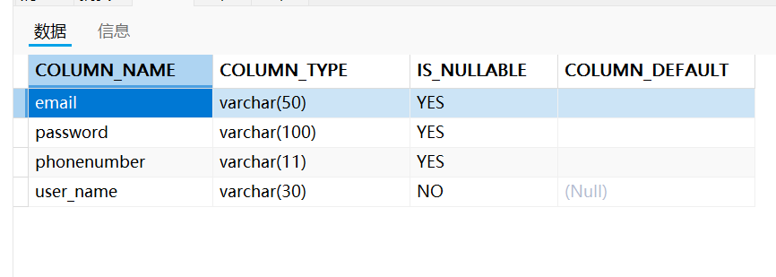
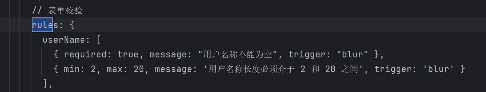
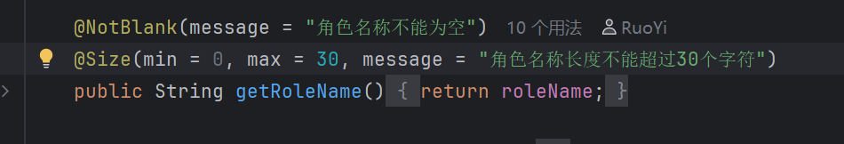

## 缺陷清单

被测系统：RuoYi-Flowable（本地 Docker 部署）
测试范围：登录模块、用户管理模块
记录方式：自动化断言（xfail 标记）+ 手工探索

### D1 新增用户接口未校验密码必填

- **严重程度**：高
- **发现方式**：接口自动化（用例 u106，xfail 标记）+ 数据库取证
- **复现步骤**：
  1. 以 admin 登录取得 token
  2. 调用 `POST /system/user`，`password` 传空字符串，其余字段合法
  3. 接口返回 `code=200`，用户创建成功
- **预期结果**：接口应拒绝创建，与前端密码框的必填标识一致
- **实际结果**：创建成功，`sys_user.password` 落库为 60 位 BCrypt 哈希（`$2a$10$` 开头）
- **证据**：
  - 数据库字段：`password varchar(100)`，`IS_NULLABLE = YES`，无默认值——数据库层不设防

  - 落库结果：`SELECT LEFT(password,7), LENGTH(password) FROM sys_user WHERE user_name='probe_xxx'`
    → `$2a$10$`, `60`（空字符串被正常加密后落库）
  - 接口响应：`{"code":200,"msg":"操作成功"}`
- **根因分析**：`SysUser` 实体被新增与修改接口复用，`password` 无法添加 `@NotBlank`
  （否则修改昵称也会被要求填密码）；校验责任被推至前端，而前端 `rules` 与必填标识脱节，
  导致前后端均未拦截
- **修复建议**：使用分组校验（`AddGroup` / `EditGroup`）区分新增与修改场景，
  或在 Controller 层对新增请求单独校验非空 
- **回归方式**：用例 u106，缺陷修复后 xfail 自动转为 XPASS


阅读前后端源码定位校验逻辑，通过接口层绕过前端验证后端实现，累计发现缺陷 8 项（含安全类 6 项）：密码 HTTP 明文传输、前端 JS 硬编码 RSA 私钥、新增用户接口未校验密码必填（可绕过前端创建空密码账号，落库为 BCrypt 哈希）、手机号仅校验长度不校验格式、用户详情接口返回密码哈希、前后端校验口径不一致。

前端限 20，后端和数据库限 30


---

# 缺陷清单

**被测系统**：RuoYi-Flowable（本地 Docker 部署，MySQL 8.4，后端 `http://localhost:8080`）
**测试范围**：登录模块、用户管理模块
**记录方式**：接口自动化（pytest + xfail 标记）、手工探索、数据库取证、前后端源码比对
**缺陷总数**：8 项（含安全类 6 项）

---

## 测试视角总结

本次测试按「敏感数据全链路」组织，沿数据流向逐段检查：**传输层是否加密、输入侧是否校验、输出侧是否脱敏**。六条安全类缺陷恰好分布在这三个位置，根源是同一个。

| 层次 | 应有职责 | 实际情况 |
| --- | --- | --- |
| 前端 | 保证用户体验、减少误操作 | 有校验规则，但可绕过（直接调接口） |
| 传输 | 密码不以可还原形式出网 | 未启用 HTTPS；前端 RSA 因私钥硬编码而失效 |
| 后端 | 安全边界，独立校验所有输入 | 密码非空、手机号格式、用户名边界均未校验 |
| 数据库 | 兜底约束 | `password` 允许为空，`user_name` 无唯一索引 |
| 输出 | 按最小必要原则返回字段 | 详情接口返回完整密码哈希 |

**根因**：各层校验分散且互不衔接，形成「每一层都假设下一层会挡住」的局面。典型例子是密码必填只在前端 `rules` 声明，后端因实体复用无法加约束，数据库字段又允许为空——三道关卡同时失守。

**结论**：前端校验属于体验层，不能作为安全边界；后端应对所有输入独立校验，数据库以约束兜底，响应侧按最小必要原则脱敏。

---

## D1 传输层未启用 HTTPS，登录密码可在链路中被还原

- **严重程度**：中
- **缺陷类型**：安全 · 传输层加密缺失
- **发现方式**：抓包分析 + 前端源码比对

**复现**：使用浏览器开发者工具或代理工具抓取 `POST /login` 请求，查看 body 中的 `password` 字段。

**预期结果**：密码不应以可还原的形式在网络上传输。

**实际结果**：请求走明文 HTTP，`password` 字段为 jsencrypt 输出的 Base64 密文；但加密所用私钥硬编码在前端 JS 中（见 D2），攻击者抓包后可直接解密得到明文。

**证据**：
- 请求使用 `http://` 协议，未启用 TLS
- 抓包中 `password` 字段为密文形态
- 解密所需私钥可从 `jsencrypt.js` 直接读取（见 D2）

**危害**：中间人可完整获取登录凭据，进而登录系统、遍历数据；同一密文可被重放提交，无法防御重放攻击。

**根因分析**：传输层未启用 HTTPS，转而依赖应用层 RSA 加密兜底。但应用层加密缺乏可信的公钥分发机制，无法抵御公钥替换，属于用业务层补丁填基础设施的缺口。

**修复建议**：在反向代理（如 Nginx）或应用层启用 TLS，一次性覆盖全部接口；随后移除前端加密逻辑，业务代码无需感知加密过程。

---

## D2 前端硬编码 RSA 公私钥，应用层加密完全失效

- **严重程度**：中
- **缺陷类型**：安全 · 密钥管理不当
- **发现方式**：前端源码阅读

**复现**：打开登录页，F12 检查 `jsencrypt.js`（或全局搜索 `publicKey` / `privateKey` / `MIGfMA0GCSq`）。

**预期结果**：客户端只应持有公钥；私钥仅存在于服务端。

**实际结果**：公钥与私钥均以明文硬编码在客户端 JS 中，注释还附带密钥对生成网址，说明为模板遗留默认值，从未更换。


```javascript
const publicKey  = "MIGfMA0GCSqGSIb3DQEBAQUAA4GNADCBiQKBgQC...";
const privateKey = "MIICdwIBADANBgkqhkiG9w0BAQEFAASCAmEwggJdAgEAAoGBAL...";
```

**危害**：任何人访问登录页即可获取私钥，从而解密自己抓到的所有登录密文。加密机制形同虚设，与 D1 组合后构成「抓包 → 解密 → 获取明文密码」的完整链条。

**根因分析**：RuoYi 前端模板为演示 RSA 加密内置了示例密钥对，项目直接沿用未做调整。深层问题在于混淆了 RSA 的使用场景——RSA 的前提是「公钥公开、私钥保密」，私钥一旦出现在客户端，整条链路即失去意义。

**修复建议**：私钥立即从前端移除；根本上应放弃前端加密方案，改为部署 HTTPS 由传输层统一解决。

---

## D3 新增用户接口未校验密码必填，可创建空密码账号

- **严重程度**：中
- **缺陷类型**：安全 · 输入校验缺失
- **发现方式**：接口自动化（用例 u106，xfail 标记）+ 数据库取证 + 哈希比对

**复现**：

```bash
curl -X POST http://localhost:8080/system/user \
  -H "Authorization: Bearer $TOKEN" \
  -H "Content-Type: application/json" \
  -d '{"userName":"repro_empty_pwd","nickName":"复现","password":"","deptId":103,"roleIds":[2],"status":"0"}'
```

**预期结果**：接口应拒绝创建，与前端密码框的必填标识一致。

**实际结果**：返回 `code=200` 创建成功；`sys_user.password` 落库为 60 位 BCrypt 哈希；该账号以空密码登录时被 `LoginBody` 的 `@NotBlank` 拦截，返回 `code=500`。

**证据**：
- 接口响应：`{"code":200,"msg":"操作成功"}`
- 数据库字段：`password varchar(100)`，`IS_NULLABLE = YES`，无默认值



- 落库结果：`SELECT LEFT(password,7), LENGTH(password) FROM sys_user WHERE user_name='repro_empty_pwd'` → `$2a$10$`，`60`
- 哈希比对：取回完整哈希后执行 `bcrypt.checkpw(b"", hash)` → `True`；`bcrypt.checkpw(b"123456", hash)` 与 `bcrypt.checkpw(b"Test@123456", hash)` → `False`。证明明文确为空字符串，排除「静默替换为初始密码」的可能
- 登录验证：`POST /login` 传空密码返回 `code=500`

**危害**：
1. **产生僵尸账号**：账号在用户列表中显示正常（有昵称、部门、角色、启用状态），但永远无法登录，占用用户名且不易被管理员察觉
2. **潜伏脆弱性**：库中留存空串哈希。当前登录接口的 `@NotBlank` 是唯一防线，若后续为支持手机号登录、扫码登录等场景调整 `LoginBody` 而放宽校验，这批账号将立即变为可登录状态

**根因分析**：`SysUser` 实体同时被新增与修改接口复用，`password` 无法添加 `@NotBlank`（否则修改昵称等场景也会被强制要求填密码）；而 `LoginBody` 是登录专用 DTO，可自由施加约束。同一字段在两个接口上校验策略相反，根源在于 **DTO 的复用程度决定了校验强度——复用得越多越不敢加约束**。

**修复建议**：
1. 使用分组校验（`AddGroup` / `EditGroup`）区分新增与修改场景，在新增场景对 `password` 施加非空约束
2. 或在 Controller 层对新增请求单独校验
3. 数据库层为 `password` 增加非空约束作为兜底
4. 登录环节保留空密码拒绝逻辑（纵深防御）

**回归方式**：用例 u106，缺陷修复后 xfail 自动转为 XPASS

---

## D4 手机号字段仅校验长度，不校验格式

- **严重程度**：中
- **缺陷类型**：安全 · 输入校验缺失
- **发现方式**：接口自动化（用例 u104，xfail 标记）+ 数据库取证

**复现**：`POST /system/user`，`phonenumber="12345"`（5 位纯数字），其余字段合法。

**预期结果**：接口应校验手机号格式，拒绝非 11 位手机号。

**实际结果**：返回 `code=200` 创建成功，库中 `phonenumber` 落库为 `12345`。

**证据**：
- 落库验证：`SELECT user_name, phonenumber FROM sys_user WHERE phonenumber='12345'`
- 字段定义：`phonenumber varchar(11)`
- **对照分析**：同一张表中 `email` 有 `@Email` 格式校验，而 `phonenumber` 仅有 `@Size(max=11)` 长度校验

**危害**：可创建手机号非法的账号；若后续启用短信验证码登录、消息推送等功能，将导致发送失败或数据污染，且非法数据进入库后难以批量识别和清洗。

**根因分析**：数据库字段 `varchar(11)` 天然限制了超长输入，开发因此认为「长度已受限、无需再加格式校验」，忽略了 11 位以内仍存在大量非法组合。与 D3 属同一模式：**用某一层的天然限制替代显式的业务校验**。

**修复建议**：后端为 `phonenumber` 添加 `@Pattern(regexp = "^1[3-9]\\d{9}$")`，与前端正则保持一致。

**回归方式**：用例 u104，缺陷修复后 xfail 自动转为 XPASS

---

## D5 前后端用户名长度校验口径不一致

- **严重程度**：低
- **缺陷类型**：安全 · 校验规则不统一
- **发现方式**：前端 `rules` 与后端实体注解比对 + 接口实测

**复现**：`POST /system/user`，`userName` 传 21 位与 30 位字符，其余字段合法。

**预期结果**：前端与后端应使用同一套长度规则。

**实际结果**：21 位与 30 位均创建成功。前端限制 2–20 位，用户在页面上无法输入，但绕过前端即可提交。

**证据**：
- 前端 `ruoyi-ui/src/views/system/user/index.vue`：

```javascript
userName: [
  { required: true, message: "用户账号不能为空", trigger: "blur" },
  { min: 2, max: 20, message: "用户账号长度必须介于 2 和 20 之间", trigger: "blur" }
]
```



- 后端 `SysUser.java`：

```java
@Size(min = 0, max = 30, message = "用户账号长度不能超过30个字符")
private String userName;
```




- 数据库：`user_name varchar(30)`
- 实测：用例 u103（30 位边界）返回 `code=200`

**危害**：21–30 位区间成为校验缝隙，绕过前端即可写入。若下游系统（报表导出、第三方对接）按 20 位设计字段长度，将出现截断或异常。

**根因分析**：同一业务规则在前端、后端、数据库三处各写一遍，缺乏统一来源。前端规则为优化体验而收紧，后端规则为兼容历史数据而放宽，两侧长期未对齐。

**修复建议**：统一规则来源（常量类或配置项），前后端引用同一值；后端调整为 `@Size(min = 2, max = 20)`。

---

## D6 用户详情接口响应包含密码哈希，未做字段脱敏

- **严重程度**：中
- **缺陷类型**：安全 · 敏感信息暴露
- **发现方式**：接口响应观察

**复现**：`GET /system/user/{userId}`，观察响应体。

**预期结果**：响应中不应包含 `password` 字段，或应返回掩码。

**实际结果**：`data.password` 返回完整 60 位 BCrypt 哈希。

**证据**：

```json
{
  "code": 200,
  "msg": "操作成功",
  "data": {
    "userId": 184,
    "userName": "autotest_1793781621249",
    "delFlag": "0",
    "password": "$2a$10$aj9sRjWQgnfJR4xt2oFexufVNErTvsfMIilhg78aL6Kla8VArfVP6"
  }
}
```

`SysUser` 实体被直接序列化返回，未做字段过滤。

**危害**：任何具备 `system:user:query` 权限的账号均可遍历 `userId` 批量导出全站密码哈希，为离线爆破与撞库提供条件。需客观说明：BCrypt 自带盐且为慢哈希（cost 因子 10），抗暴力能力较强，**危害集中在弱密码场景**，并非直接导致密码泄露。同族风险在于普通角色账号也能获取管理员哈希。

**根因分析**：Controller 直接返回 `SysUser` 实体，未使用 VO/DTO 做输出层过滤。实体同时承担「数据载体」与「接口响应」两个角色，导致内部字段随意外泄。

**修复建议**：为 `password` 添加 `@JsonProperty(access = JsonProperty.Access.WRITE_ONLY)` 或 `@JsonIgnore`；更彻底的做法是改用 VO 层，按接口需要显式声明返回字段。

---

## D7 登录验证码连续输错无次数限制与锁定机制

- **严重程度**：低
- **缺陷类型**：安全 · 防暴力破解缺失
- **发现方式**：手工测试（用例 011）

**复现**：连续多次输入错误验证码提交登录，观察是否触发锁定或延迟。

**预期结果**：达到阈值后应锁定账号或强制增加验证难度。

**实际结果**：可无限次尝试，仅单次校验失败，无累计计数与锁定。

**危害**：为验证码识别与撞库提供无限次尝试机会，降低暴力破解成本。

**修复建议**：基于 IP 与账号维度累计失败次数，超阈值后锁定或引入图形验证升级。

---

## D8 登录按钮无防误触处理，连续点击可重复提交

- **严重程度**：低
- **缺陷类型**：功能 · 交互缺陷
- **发现方式**：手工测试（用例 014）

**复现**：在登录页连续快速点击登录按钮。

**预期结果**：请求发出后按钮应禁用，避免重复提交。

**实际结果**：可连续发出多次登录请求。

**危害**：产生重复登录记录，在并发场景下可能造成 token 覆盖或日志冗余。

**修复建议**：请求发出后立即置 `loading` 状态禁用按钮，响应返回后恢复。


## 附：设计观察

以下为测试过程中的观察，因涉及产品设计取向或影响轻微，记录供参考：

- **密码框缺少显示/隐藏切换**：用户无法核对输入内容，易输错
- **「记住密码」功能异常**：账号密码被写入前端固定位置，清除浏览器数据后失效
- **传 `null` 时后端异常信息透传**：响应返回 `rawPassword cannot be null`，暴露内部实现细节
- **`sys_user.user_name` 无唯一索引**：「用户名不重复」完全依赖代码层校验，数据库层不设防
- **参数校验失败返回 500**：语义上应为 400，属 HTTP 状态码误用，会干扰前端判断与监控告警


